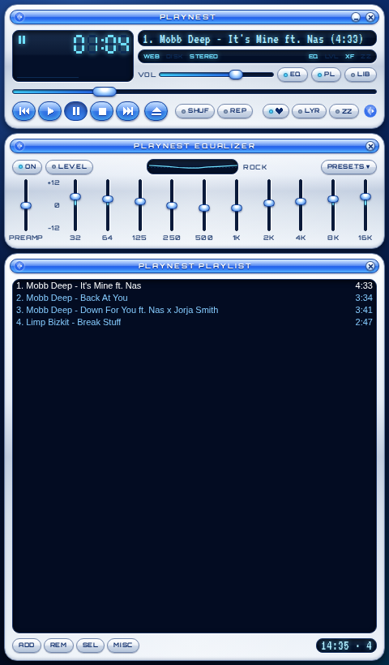
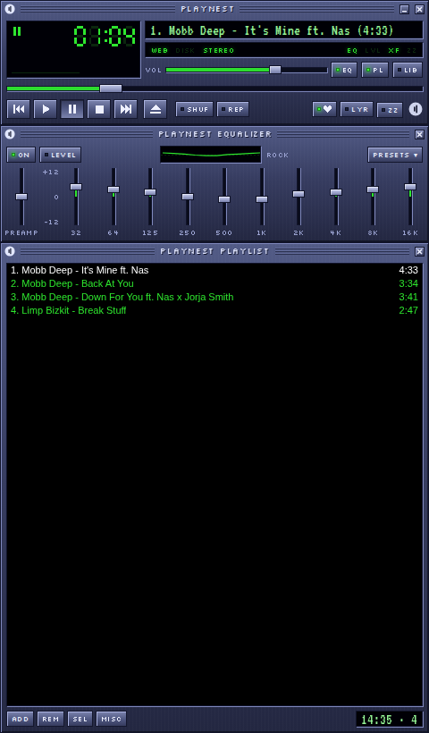
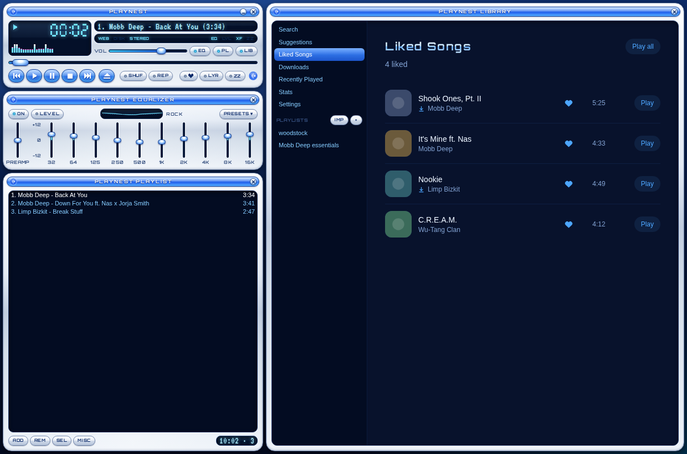

# Playnest

A free, open source desktop music player for Windows with a Y2K soul.
Search for any song, build playlists, and get suggestions based on what
you actually listen to. No account, no subscription. Built with Tauri
(Rust) + React.

<p align="center">
  
  
</p>
<p align="center">
  
</p>

## Download

Get the latest installer from the [**Releases**](https://github.com/SkywalkerPZ/playnest/releases/latest)
page (`playnest_x.y.z_x64-setup.exe`). Windows may say "Windows protected
your PC" because the installer isn't code-signed: click **More info →
Run anyway**. On first launch Playnest downloads yt-dlp, the engine it
plays music with, and from then on it updates itself.

## Features

- A compact classic player, equalizer and playlist, with four skins (Y2K
  chrome, Classic green, Black & green, Midnight blue) or a modern
  full-window layout
- Search, playlists (create, reorder, import from YouTube), liked songs,
  queue, play next, shuffle, repeat, crossfade, sleep timer
- Suggestions and autoplay from your own listening, artist pages, stats
- Synced lyrics, 10-band equalizer with preamp, volume levelling
- Offline downloads, backup and restore, global hotkeys, tray icon,
  Discord status
- Updates itself (Playnest and yt-dlp), with a changelog for each version

## Disclaimer

Playnest is an independent project and isn't affiliated with, endorsed
by or connected to YouTube or Google. It doesn't host or distribute any
music: it plays what you search for, using the open source
[yt-dlp](https://github.com/yt-dlp/yt-dlp). You're responsible for how
you use it and for respecting the terms of the services you access and
the laws where you live. Please support the artists you listen to.
Released under the MIT License (see `LICENSE`).

## How playback works

There's no bundled audio or scraping of a paid service. The Rust backend
shells out to [`yt-dlp`](https://github.com/yt-dlp/yt-dlp) to:

1. **Search** — `search_tracks` runs `yt-dlp "ytsearch15:<query>" --flat-playlist -j`
   and parses the results into `Track`s.
2. **Play** — `get_stream_url` runs `yt-dlp -f bestaudio -g <url>` to resolve
   a direct, playable audio stream URL, which is handed to a plain HTML5
   `<audio>` element in the frontend.

Nothing is downloaded or cached to disk by default — it's a pure stream.

## Prerequisites

To **build** Playnest you need:

1. **Node.js** 18+ and npm
2. **Rust**: install via [rustup.rs](https://rustup.rs)
3. **Tauri's platform dependencies**: follow the
   [Tauri prerequisites guide](https://v2.tauri.app/start/prerequisites/) for
   your OS (on Windows this means the MSVC C++ Build Tools; on Linux this
   pulls in `webkit2gtk` and friends)

To **use** it, nothing else. Playnest downloads its own copy of yt-dlp
(see below). ffmpeg isn't needed: streams and downloads use the audio as
YouTube serves it, without converting.

## yt-dlp: Playnest keeps its own copy

On first launch on a PC without it, Playnest downloads the official
standalone yt-dlp (about 18 MB) from yt-dlp's GitHub releases into its
data folder (`%LOCALAPPDATA%\com.playnest.app\bin` on Windows, or
wherever your app identifier points), with a progress screen. The file is
checked against the release's published SHA-256 checksums before it's
used; a mismatch is thrown away.

- Once a day, on launch, Playnest quietly runs `yt-dlp -U` on its copy,
  because YouTube changes break older versions.
- **Settings → yt-dlp → Check for updates** updates it on demand. If
  Playnest was still using a yt-dlp from PATH (say, one installed with
  pip, which can't update itself), this switches it to its own copy.
- Until it has its own copy, a `yt-dlp` on PATH is used, so a
  development setup keeps working as before.
- If the first download fails (no internet), there's Try again, or
  Continue without it (downloaded songs still play).

## Running it

```bash
npm install
npm run tauri dev
```

This starts the Vite dev server and opens the Tauri window.

## Before you build a distributable

The app needs real icon files under `src-tauri/icons/` (referenced in
`tauri.conf.json`). Generate a full set from a single 1024×1024 PNG of the
Playnest logo (`playnest-logo.png`, included in this project's root):

```bash
npm run tauri icon playnest-logo.png
```

Then package with:

```bash
npm run tauri build
```

## Local storage

Playlists, liked songs, downloads, settings, your last queue/now-playing
state, search history, and your play log are all stored in a local SQLite database (via
`tauri-plugin-sql`), created automatically on first launch — no setup
needed. On Windows it lands under
`%APPDATA%\com.playnest.app\playnest.db`; on macOS under
`~/Library/Application Support/com.playnest.app/playnest.db`.

## Search

- **Recent searches** show up under the box when you click into it. Remove
  one with its ✕, or clear them all. Note that search history also feeds
  Suggestions.
- **Songs only** (a chip under the box, remembered between sessions) hides
  full albums, concerts, hour-long mixes and live streams.
- **Load more** fetches the next page of results (up to 200).

## Artist pages

Click an artist's name anywhere (in a track row or the now-playing bar) to
open their page. It shows the tracks by them you've played most, then more
of their songs, with Play all and Shuffle. It's built from your local play
history plus a search, since there's no official artist database behind it.

## Play next

Every track's ⋯ menu has **Play next**, which puts it at the front of the
queue. In the Queue view it moves a track to the top.

## Keeping yt-dlp up to date

YouTube changes things regularly, and when it does, older yt-dlp versions
stop being able to search or play. When that happens:

- Playnest's own copy already updates itself once a day (see above).
- **Settings → yt-dlp → Check for updates** updates it right away and
  shows the old and new versions.
- If a search fails, the error has an **Update yt-dlp** button, and the
  search is retried automatically after a successful update.

Every yt-dlp call runs with no console window, so the installed app doesn't
flash a black window on each search or track.

## Updates: Playnest updates itself

Installed copies check your update site about twice a day (and on
**Settings → Playnest updates → Check for updates**). When there's a newer
version, a window shows what's new, with **Update now**, **Later** and
**Skip this version**. Update now downloads the installer, checks its
signature, installs it without questions, and reopens Playnest. After an
update, a "What's new" window appears once.

Every release is signed with a private key that only you have; installed
copies refuse anything not signed with it.

### One-time setup

1. Make a free account at [netlify.com](https://www.netlify.com). Open
   [app.netlify.com/drop](https://app.netlify.com/drop) and drop any small
   folder to create a site, then in **Site configuration → Change site
   name** give it an unguessable name, like `playnest-k7q2m9`. Its address
   is `https://playnest-k7q2m9.netlify.app`. It isn't listed anywhere, and
   the download page tells search engines not to index it.
2. In the Playnest folder, run:

   ```
   npm run updater:setup -- https://playnest-k7q2m9.netlify.app
   ```

   This creates your signing key at `C:\Users\<you>\.tauri\playnest.key`
   and writes the site address and public key into `tauri.conf.json`.
3. **Back up `playnest.key` and `playnest.key.pub`** (USB stick, password
   manager). Lose them and installed copies can't be updated any more.

The first build after setup is the one to install on the family's PCs,
since only copies built with the key know where to look for updates.

### Releasing a new version

1. Bump the version in `package.json`, `src-tauri/tauri.conf.json` and
   `src-tauri/Cargo.toml` (all three the same, e.g. `0.3.0`).
2. Add a section at the top of `CHANGELOG.md`:

   ```
   ## 0.3.0 - 2026-10-04

   - What changed, in plain words.
   ```

   These lines are exactly what people see in the update window.
3. Run `npm run release`. It builds and signs the installer and fills the
   `release` folder with the installer, `latest.json` (the version, notes
   and signature the app reads) and `index.html` (a download page for
   first installs).
4. On app.netlify.com open your site → **Deploys**, and drag the
   `release` folder onto the page.

The release script stops with a clear message if the versions don't
match, the changelog section is missing, or the key isn't the one the app
trusts.

## Releasing on GitHub

The GitHub workflow in `.github/workflows/release.yml` builds the signed
Windows installer on GitHub's own Windows machines and publishes a
release with the changelog as its notes, plus the `latest.json` the
updater reads. Installed copies check GitHub first and Netlify second.

**Once:** in the repository on github.com, open **Settings → Secrets and
variables → Actions → New repository secret**, name it
`TAURI_SIGNING_PRIVATE_KEY`, and paste the whole contents of your
`playnest.key` (open it in Notepad). Only GitHub's build machines can read
it; it never appears in the code or the logs.

**Each version:**

1. Bump the version in `package.json`, `src-tauri/tauri.conf.json` and
   `src-tauri/Cargo.toml`, and add its section to the top of
   `CHANGELOG.md`.
2. Commit and push, then tag the version and push the tag:

   ```
   git tag v0.2.3
   git push origin v0.2.3
   ```

   (With GitHub Desktop: commit and push, then **Repository → Create
   tag…** on the latest commit, and push again.)
3. Watch it build under the repository's **Actions** tab (about 10–15
   minutes). When it's green, the release is on the **Releases** page and
   installed copies will offer it.

The workflow stops early, with a message, if the tag doesn't match the
version, the three version numbers differ, or the changelog section is
missing.

Copies installed before GitHub was set up only know the Netlify site. For
the first GitHub release, also run `npm run release` and deploy that
folder to Netlify once, so those copies update to a version that knows
about GitHub.

## Classic layout and skins

Playnest opens as a compact classic player: three stacked panels in a
narrow, frameless window.

- **Player**: big LCD time (click it to switch between elapsed and
  remaining), a small spectrum analyser, the scrolling track title,
  status lights (WEB/DISK, EQ, LVL, XF, ZZ), volume, the seek bar and
  transport buttons (previous, play, pause, stop, next, and ⏏ to find
  music). Play restarts a track that's already playing; stop goes back
  to the start. Then shuffle, repeat (REP / REP 1), like, lyrics, the
  sleep timer (ZZ), and EQ / PL / LIB to show or hide the other panels.
- **Equalizer**: ON, LEVEL (volume levelling), the curve display,
  PRESETS, a preamp and ten bands. Drag the sliders, use the arrow keys
  on a focused slider, or double-click a slider to reset it to 0.
- **Playlist**: the playing track followed by what's up next. Click to
  select (Ctrl/Shift for more), double-click to play, Delete to remove,
  drag to reorder. ADD brings in search, Liked Songs, Downloads or a
  YouTube playlist; REM, SEL and MISC remove, select, shuffle, sort,
  reverse, or save the list as a playlist.
- **Library** (LIB or ⏏): opens beside the player and widens the window,
  with Search, Suggestions, Liked Songs, Downloads, Recently Played,
  Stats, Settings and your playlists. Lyrics open here too.

Drag any title bar to move the window. Hiding the playlist shrinks the
window to just the player (and equalizer).

**Settings → Appearance** switches between the four skins and between
the classic and the modern layout (the full window with a sidebar):

- **Y2K chrome** (default): brushed-silver rounded panels on a deep blue
  backdrop, blue gel buttons, a glowing cyan display, built around the
  logo's blue.
- **Classic green**, **Black & green**, **Midnight blue**: square,
  bevelled, green-on-black displays.

The fonts (VT323, Silkscreen, Orbitron) are bundled, so the look works
offline. The logo is
Playnest's own; the classic look is a homage, not a copy of any other
player's artwork.

## Welcome page

On first launch (and only then — it's a one-time flag stored locally),
Playnest shows a short welcome screen introducing the app before dropping
into the normal search view. It doesn't ask for anything or send any data
anywhere; it's purely a local "have I seen this before" check.

## Suggestions

The Suggestions tab (in the sidebar) recommends tracks based on your own
search, listening and like history — there's no licensed recommendation API
wired in, so this works by re-searching (via the same yt-dlp search
everything else uses) around the artists you've actually played most and
the terms you've searched most recently, then filtering out anything
you've already played. Every suggestion shows a plain-language reason
("Because you listen to X", "Because you searched Y") rather than
presenting picks as a black box. With no history yet, it tells you to
search and play a few tracks first rather than showing anything fake.

## Backup and restore

**Settings → Backup → Export library** saves your playlists (in order),
liked songs, play history, searches, settings, EQ and lyric timings to one
JSON file wherever you choose. **Restore from a backup** merges it back in:

- A playlist with the same name gets only the missing tracks added; your own
  additions stay.
- Likes, plays and searches that are already there are skipped, so
  restoring twice changes nothing.
- Settings are replaced by the backup's.
- Downloaded audio isn't in the backup. Download those tracks again after
  restoring.

Backup files are validated before anything is written: other JSON files,
newer backup versions, bad track IDs, non-https thumbnails and undated
history entries are rejected or dropped.

## Keyboard shortcuts

While the Playnest window is focused:

| Key | Action |
|---|---|
| Space | Play / pause |
| N / P | Next / previous track |
| L | Like / unlike the current track |
| ← / → | Seek back / forward 5s |
| ↑ / ↓ | Volume up / down |

Shortcuts are disabled while typing in a text box.

## Global hotkeys and the system tray

These work even when Playnest is in the background (e.g. mid-game):

| Keys | Action |
|---|---|
| Ctrl + Alt + Space | Play / pause |
| Ctrl + Alt + → | Next track |
| Ctrl + Alt + ← | Previous track |

If another app already owns one of these, that one silently doesn't
register and the rest still work.

Playnest also puts an icon in the system tray with Play / Pause, Previous,
Next, Show Playnest and Quit. Left-clicking the icon brings the window back.
Both the tray and the hotkeys are wired in Rust and send a
`playnest://player-action` event that the frontend listens for.

## Previous, autoplay, crossfade and the sleep timer

- **Previous** goes back through what you actually played. Pressed more
  than 3 seconds into a track, it restarts the track instead, like most
  players.
- **Autoplay** (on by default, toggle in Settings): when the queue runs out,
  Playnest looks up more tracks by the same artist, mixed with your other
  most-played and liked artists, and keeps going. Hour-long mixes and full
  concerts are skipped.
- **Crossfade** (off by default, 2 to 12 seconds in Settings) blends one
  track into the next using two audio elements. It starts a few seconds
  early to cover the stream lookup, and also applies when you press Next.
- **Sleep timer** (moon icon in the now-playing bar): stop after 15 to 90
  minutes (with a 10-second fade out), or at the end of the current track.

## Cleaner titles

Titles are tidied up for display: "Mobb Deep - It's Mine (Official Video)
ft. Nas" shows as **It's Mine ft. Nas** by **Mobb Deep**. Uploader names
like "NirvanaVEVO" or "Queen - Topic" become the artist name. "Live at …"
is kept, because it tells you which version you're hearing. The original
title is still stored and shows on hover. The cleaned version is also used
for lyrics lookups (which match noticeably more often), Discord and your
OS media controls.

## Library: liked songs, playlists, import

- **Liked Songs:** the heart on any track or in the now-playing bar (or press
  L). Likes count three times as much as a single play when Suggestions and
  autoplay decide what you're into.
- **Playlists:** click a playlist's name to rename it, and drag tracks to
  reorder them. The queue can be drag-reordered too.
- **Import:** the "Import" button next to Playlists takes a YouTube or
  YouTube Music playlist link and turns it into a normal local playlist.
  Private and deleted entries are skipped.

Every track row has a ⋯ menu with Add to queue, Download for offline, and
Add to playlist (existing or new).

## Offline downloads

"Download for offline" in a track's ⋯ menu saves the audio (via yt-dlp) into
Playnest's own data folder, `%APPDATA%\com.playnest.app\downloads` on
Windows. Downloaded tracks play from disk, so they work with no internet,
and they're listed on the Downloads page. If a downloaded file goes missing,
Playnest falls back to streaming. Deleting only ever touches files inside
that downloads folder.

Worth knowing: saving copies of YouTube audio goes further than streaming
does against YouTube's terms. That's fine for your own listening, but it's
something to think about before distributing a build that does this.

## Stats

The Stats page shows total plays, estimated listening time, number of
artists and liked songs, a plays-per-day chart for the last 30 days (with a
table view), and your top artists and tracks. Everything is computed from
the local play log, which now keeps your last 5,000 plays. Listening time is
an estimate from track lengths, since Playnest doesn't record how much of
each track you heard.

## Shuffle & repeat

The shuffle and repeat buttons sit either side of play/pause in the
now-playing bar. Repeat cycles through off → repeat all → repeat one.
"Repeat all" works by remembering everything that's been played since the
queue last emptied, then refilling the queue from that history once it
runs out.

## Lyrics

Click "Lyrics" in the now-playing bar to open the lyrics panel. It looks
up lyrics via [lrclib.net](https://lrclib.net), a free, community-sourced
lyrics database with no API key required. When synced (LRC-format) lyrics
are available, the current line auto-highlights and scrolls as the track
plays; otherwise it falls back to plain unsynced lyrics, or a "not found"
message.

Two things worth knowing:
- **Match quality depends on the title.** YouTube titles are often messy,
  so the search-based lookup doesn't always find a match, or occasionally
  finds the wrong one.
- **Licensing**: lrclib.net is a community database, not a licensed
  lyrics provider — using it is the same kind of gray area as streaming
  from YouTube (see below): fine for personal use, worth revisiting with a
  properly licensed provider before any public release.

## Sound: visualizer, equalizer, volume levelling

In the modern layout the **Sound** page (bottom of the sidebar) has these; in the classic layout they live in the Equalizer panel (which also has a preamp) and the player's little spectrum display:

- **Visualizer:** live frequency bars on a log scale, so bass isn't
  squeezed into the first couple of bars.
- **Equalizer:** 10 bands (32 Hz to 16 kHz, ±12 dB) with presets (Bass
  boost, Vocal, Rock, Hip-hop, Late night, and more). Dragging a band
  switches to "Custom".
- **Volume levelling:** evens out loudness between tracks. It measures each
  track's average level over its audible parts (silence is ignored) and
  nudges it toward a common target, adjusting quickly in the first seconds
  and slowly after that, so it doesn't pump within a song. A limiter at the
  end stops EQ boosts or levelling from clipping.

### How it works: the local audio relay

YouTube's stream URLs don't send CORS headers, so the webview is allowed to
play them but not to read the audio. The Web Audio API needs to read it for
all three features above. So Playnest runs a tiny HTTP relay inside the app
(`src-tauri/src/relay.rs`) that serves the same bytes with CORS headers, and
every track (streamed or downloaded) plays through it.

- It listens on `127.0.0.1` only, on a random port.
- It is **not** an open proxy: it only serves sources Playnest registered
  itself, each under a random 128-bit token. Other programs or web pages
  can't use it to fetch arbitrary URLs or read files.
- Byte ranges are passed through, so seeking works.
- If the relay can't start, playback falls back to the old direct URLs and
  the Sound page explains that effects are off.

Audio flows: both players → per-player gain (volume and crossfade) → mix →
10-band EQ → leveller → limiter → analyser (visualizer) → speakers.

## Recently Played

Every track you play is logged locally and viewable from the sidebar. It's
a history log, separate from playlists, and it feeds Suggestions, autoplay
and Stats.

## Discord Rich Presence

Playnest can show what you're playing in your Discord profile (title,
artist, and a running timer), the same way Spotify's integration works.
It talks directly to your local Discord desktop app over IPC — nothing
goes through a server, and if Discord isn't running it just silently
does nothing rather than erroring.

To turn it on:

1. Go to the [Discord Developer Portal](https://discord.com/developers/applications)
   and click **New Application**. Name it "Playnest" (or anything you like).
2. Copy the **Application ID** shown on the General Information page.
3. Open `src-tauri/src/main.rs` and replace the placeholder:
   ```rust
   const DISCORD_CLIENT_ID: &str = "YOUR_DISCORD_CLIENT_ID";
   ```
   with your actual Application ID.
4. In the portal, go to **Rich Presence → Art Assets** and upload
   `playnest-logo.png` (in this project's root) as an asset. Set its
   **name** to exactly `playnest_logo` — the code references that key
   directly.
5. Rebuild. Play something with Discord open and your status should
   update within a few seconds.

If you skip this setup, playback works exactly as before — the presence
calls just fail silently and nothing shows up on Discord.

## Project structure

```
src/                       React frontend
  classic/                  the classic layout
    ClassicLayout.tsx       the stacked panels, and sizing the frameless window
    MainWindow.tsx          LCD, spectrum, title, transport, toggles
    EqualizerWindow.tsx     presets, preamp, 10 bands, curve
    PlaylistWindow.tsx      now playing + up next, ADD/REM/SEL/MISC
    LibraryPanel.tsx        library nav + the regular pages
    parts.tsx               title bar, seven-segment digits, marquee, spectrum, menus, sliders
    windowControls.ts       safe wrappers for the native window
    skins.css, classic.css  the square skins, and the bevelled chrome
    y2k.css                 the Y2K chrome skin (colours and rounded shapes)
  components/
    Sidebar.tsx             navigation, library sections, playlists + Import
    TrackRow.tsx            the one row used by every track list (like, ⋯ menu, play, drag)
    TrackMenu.tsx           the ⋯ menu: queue, download, add to playlist, extra actions
    TrackActions.tsx        context giving every row like/download/playlist state and actions
    ListPage.tsx            shared page frame (header, loading/empty states)
    SearchView.tsx          search box, recent searches, Songs only, Load more
    ArtistView.tsx          artist page (your top tracks + more from them)
    SuggestionsView.tsx     suggestions, each with its reason
    QueueView.tsx           drag-reorderable queue
    PlaylistView.tsx        rename, reorder, play all, delete
    StatsView.tsx           stat tiles, 30-day chart/table, top artists and tracks
    SettingsView.tsx        appearance, autoplay, crossfade, backup, shortcut reference
    ImportPlaylistDialog.tsx
    SleepTimerMenu.tsx
    NowPlayingBar.tsx       transport (prev/play/next), like, sleep timer, lyrics, volume
    SoundView.tsx           visualizer, equalizer, volume levelling
    LyricsPanel.tsx, WelcomePage.tsx
  lib/
    db.ts                   all SQLite access
    titles.ts               title/artist cleanup, song-length check
    artist.ts               artist page data
    recommendations.ts      Suggestions + autoplay radio
    stats.ts                play-log aggregation
    settings.ts             persisted settings
    audioGraph.ts           Web Audio chain: player gains, EQ, leveller, limiter, analyser
    backup.ts               export, validation, merge-restore
    useDragReorder.ts       HTML5 drag-and-drop reordering
    lyrics.ts, discord.ts, format.ts, types.ts
  lib/changelog.ts          reads CHANGELOG.md (bundled) for "What's new"
  lib/appUpdate.ts          checking for and installing Playnest updates
  App.tsx                   state, the two-element playback engine, and wiring
                            (renders the classic or the modern layout)

src-tauri/                 Rust backend
  src/main.rs              search (paged), stream URLs, lyrics, playlist import, downloads,
                           yt-dlp version/self-update (all yt-dlp calls without console windows),
                           backup save/open dialogs, Discord presence, tray, global hotkeys,
                           SQL migrations 1-4
  src/engine.rs            Playnest's own yt-dlp: verified download, daily self-update
  src/relay.rs             local audio relay (token-only, loopback-only), with tests
  tauri.conf.json          window/bundle config; asset protocol scoped to the downloads folder
  capabilities/default.json

scripts/                   updater:setup, release (Netlify) and ci-notes (GitHub)
.github/workflows/         release.yml (tagged releases) and ci.yml (checks)
docs/screenshots/          images for this README
CHANGELOG.md               what's new in each version (shown in the app)
playnest-logo.png          source logo (also the Discord art asset)
```

Database changes are always added as a new migration at the end of
`migrations()` in `main.rs`. Never edit an existing migration, not even
its whitespace, or existing databases will refuse to open.

## The accounts backend (playnest-server) is on standby

A separate Rust project, `playnest-server`, exists for accounts/social —
signup, login, JWT + refresh tokens, Argon2 password hashing, the works.
It's deliberately not deployed yet; this Playnest desktop app works fully
standalone without it. See that project's own README when you're ready to
pick it back up.

## Shelved: mini player

A compact always-on-top second window was attempted and shelved — it
consistently failed to load any content across several different
approaches to fixing it. If revisited, a fully separate minimal static
HTML file for that window (no React, no shared app bundle) would be a
more debuggable starting point than reusing the whole app a second time.

## Where this goes next

Roughly the order from here, per the original plan:

1. ~~Local playlists~~ — done
2. ~~Shuffle, repeat, keyboard shortcuts, media keys, lyrics, visualizer,
   recently played~~ — done (mini player attempted, shelved — see above)
3. ~~Welcome page, suggestions~~ — done
4. ~~Previous, title cleanup, autoplay, liked songs, rename/reorder,
   playlist import, sleep timer, stats, tray, global hotkeys, crossfade,
   offline downloads~~ — done
5. ~~Play next, recent searches, Songs only, Load more, artist pages,
   yt-dlp updater~~ — done
6. ~~Audio relay with visualizer, equalizer and volume levelling; library
   backup~~ — done
7. **Accounts + backend** — built (`playnest-server`), on standby until
   deployed
8. **Social** — follow other users, browse their public playlists, share
   links

A legal note worth keeping in mind as this grows: streaming from public
video sources is a legal gray area in a lot of jurisdictions and against
YouTube's own terms of service, even though tools like yt-dlp are
themselves legal to distribute. Worth reading up on this for wherever you
plan to host or distribute Playnest.
